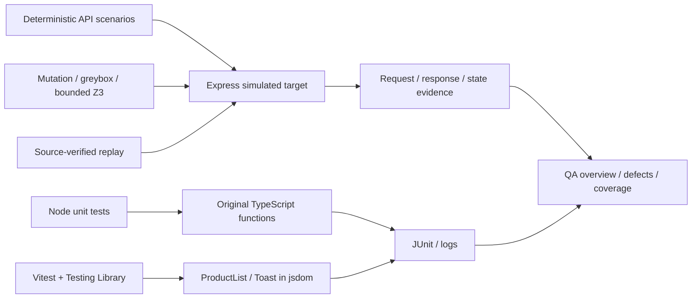

# VFitAI QA Portfolio

Dự án kiểm thử phần mềm phát triển từ ứng dụng bán hàng và thử đồ VFitAI:
thiết kế testcase, kiểm thử API, unit automation, fuzzing và báo cáo lỗi có bằng chứng.
API chạy trên Express với datastore mô phỏng; unit test chạy trực tiếp mã TypeScript
của ứng dụng gốc. Không cần dịch vụ production.

**Công nghệ:** Python · Node.js/Express · node:test · unittest · Z3 · JUnit XML · GitHub Actions.

[**Bắt đầu từ QA Overview →**](qa/README.md)

## Testing scope

Hai phạm vi độc lập: API Express mô phỏng cho acceptance/replay/fuzzing, và mã
TypeScript/React gốc cho unit/component test. Frontend chưa kết nối target API thành
E2E hoàn chỉnh; không mô tả kết quả dưới đây là kiểm thử production hoặc full-stack E2E.

| Phần | Nội dung |
|---|---|
| [Test plan](docs/test-plan.md) | Phạm vi, rủi ro, chiến lược, điều kiện chạy và kết thúc |
| [Manual testing](manual-testing/README.md) | 12 testcase UI được thiết kế; hiện NOT_RUN |
| [API testing](api-testing/README.md) | 29 testcase, 51 scenario cố định; input, oracle và state/response |
| [Unit automation](automation-testing/README.md) | 14 test cho gợi ý size và xử lý request timeout |
| [Fuzz testing](fuzz-testing/README.md) | Mutation HTTP, greybox line coverage và concolic Z3 giới hạn |
| [Bug reports](bug-reports/README.md) | Expected/actual, severity, tái hiện và bằng chứng |
| [Báo cáo](reports/README.md) | JSON, Markdown, JUnit và snapshot chọn lọc |

[Coverage đủ 29 API case](qa/test-coverage.md) · [Mô tả dùng cho CV](docs/cv.md).

## QA highlights

| Phạm vi đo | Kết quả đã chạy | Bằng chứng |
|---|---|---|
| Unit logic ứng dụng | 14/14 PASS | [JUnit](reports/baseline/unit-junit.xml) |
| React component riêng | 14/14 PASS, ProductList/Toast trong jsdom | [JUnit](reports/current/frontend/components-junit.xml) |
| Regression fuzz tool | 34/34 PASS, kiểm tra công cụ | [Log](reports/baseline/fuzz-tool-regression.txt) |
| Reporting/replay contract | 9/9 PASS, kiểm tra công cụ | [Log](reports/current/reporting-regression.txt) |
| API acceptance | 51 scenario: 19 PASS / 32 FAIL; tổng hợp 29 testcase: 9 PASS / 20 FAIL | [Execution](qa/test-execution.md) |
| Replay đại diện | 20 FAIL testcase × 2 lượt, 40 lượt tái hiện | [Report](reports/current/replay/report.md) |

Không tính một tỷ lệ PASS chung cho các hàng. 12 manual UI testcase chưa chạy;
105 ca Excel ngoài campaign API có [ID và lý do](qa/excluded-testcases.csv).

## Test architecture



Không có luồng frontend → backend E2E đã xác minh trong sơ đồ này.

## Test results & defects

[Defect register](qa/defect-register.md) ghi đủ 20 testcase FAIL: expected/actual,
severity, bằng chứng, replay và regression scenario cố định. Chúng được gom thành
17 nhóm triệu chứng sơ bộ; số lỗi gốc độc lập **chưa xác định**, không gọi là 20 bug.
[Năm bug report chi tiết](bug-reports/README.md) đều OPEN; chưa sửa target hoặc retest sau sửa đạt.

## Cài và chạy

CI dùng Python 3.12, Node.js 24 và npm. Từ repo root:

```sh
python -m pip install -r requirements.txt
npm ci --prefix fuzz-testing/target
python tools/run_checks.py --suite smoke
```

Smoke chạy unit ứng dụng, regression của công cụ và bốn đối chứng API. Để kiểm tra
đủ 51 scenario API cùng một campaign fuzzing ngắn có Z3:

```sh
python tools/run_checks.py --suite full
```

Replay kiểm tra hash source trước khi chạy (dùng output mới cho mỗi lần). Tạo report
ngay trên checkout hiện tại rồi chạy replay, kể cả khi lệnh API trả exit 1:

```sh
python api-testing/run_suite.py --suite full --output reports/runs/acceptance-demo
python api-testing/replay_failures.py --report reports/runs/acceptance-demo/report.json --repeats 2 --output reports/runs/replay-demo
```

Component suite có dependency frontend riêng; không cần backend:

```sh
npm ci --prefix archive/vfitai/client
python tools/run_frontend_checks.py
```

[Campaign fuzzing có metrics](qa/fuzzing-quality.md) ghi mọi input và tỷ lệ schema
advisory; [frontend diagnostics](qa/frontend-quality.md) tách component khỏi build/lint.

Lần chạy tổng hợp có `reports/runs/<id>/summary.md`; report API và JUnit nằm cùng
lần chạy. Các lệnh frontend và replay riêng tạo `report.md` trong thư mục output.
Full suite trả exit 1 khi target vi phạm yêu cầu; exit 2 nếu có lỗi runner hoặc ca
chưa chạy. Không đổi FAIL thành PASS để làm xanh CI. Fuzz runner hoàn tất vẫn có
thể phát hiện lỗi; xem report từng bước.

## Limitations & next improvements

[Evidence index hiện hành](qa/evidence-index.md) phân biệt baseline, replay mới,
component/metrics mới và tài liệu lịch sử. Workflow QA, fuzzing và frontend được
tách riêng; legacy typecheck/lint có thể chạy bằng workflow_dispatch, lỗi sẽ báo đỏ.
Chưa xác nhận GitHub Actions remote trước khi push.

Frontend còn 112 TypeScript diagnostic, 210 lint error và 14 warning; Vite bundle
NOT_RUN do typecheck lỗi. Component scope đạt không có nghĩa toàn bộ Vitest/frontend đạt.
Chưa có branch coverage toàn ứng dụng, benchmark tải hoặc symbolic execution toàn JavaScript.

Target API mô phỏng và hai hàm unit không đại diện cho ứng dụng production hay
browser E2E. 105 testcase Excel ngoài campaign API và 12 testcase UI chưa được gán PASS.
Mã web/E2E cũ ở [archive/](archive/README.md); lịch sử Git và bằng chứng cũ được giữ.

[Quy ước đóng góp](CONTRIBUTING.md) · [MIT](LICENSE)
