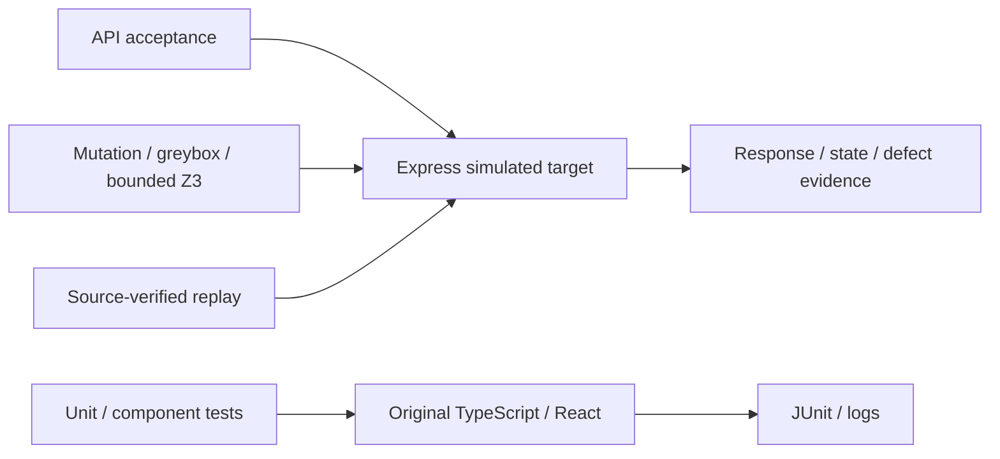

# VFitAI QA Portfolio

Dự án kiểm thử phần mềm phát triển từ ứng dụng bán hàng và thử đồ VFitAI: thiết kế testcase theo rủi ro, kiểm thử API, unit/component automation, fuzzing và báo cáo lỗi có thể tái hiện.

**Công nghệ:** Python · Node.js/Express · Vitest · Testing Library · node:test · Z3 · GitHub Actions.

[**QA Overview**](qa/README.md) · [Test plan](docs/test-plan.md) · [Coverage Matrix](qa/test-coverage.md) · [Defect Register](qa/defect-register.md) · [Evidence](qa/evidence-index.md)

## Phạm vi kiểm thử

| Đối tượng | Nội dung |
|---|---|
| API Express với datastore mô phỏng | Đăng nhập, tạo đơn, trạng thái đơn, người dùng và sản phẩm |
| Logic TypeScript của ứng dụng gốc | Gợi ý size, giá trị biên, timeout và lỗi mạng |
| React component trong jsdom | ProductList và Toast; mock context hooks và preview boundary |
| Manual UI | 12 testcase cho đăng nhập, giỏ hàng, checkout và thử đồ; chưa thực thi |

Frontend và API mô phỏng là **hai phạm vi độc lập**, chưa được xác minh thành hệ thống E2E hoàn chỉnh.

## Kết quả đã xác minh

Snapshot ngày **15/11/2026**; môi trường và source hash nằm trong [Evidence Index](qa/evidence-index.md).

| Bộ kiểm thử | Kết quả | Bằng chứng |
|---|---|---|
| API acceptance — 29 testcase | 9 PASS · 20 FAIL · 0 ERROR/NOT_RUN | [Coverage](qa/test-coverage.md) |
| 51 scenario triển khai từ các API testcase | 19 PASS · 32 FAIL · 0 ERROR/NOT_RUN | [Report state-v1](reports/state-oracles-v1/api/report.md) |
| Replay 20 testcase FAIL | Một scenario đại diện mỗi ca, chạy 2 lần; cả 40 lượt tái hiện | [Replay state-v1](reports/state-oracles-v1/replay/report.md) |
| Unit logic ứng dụng | 14/14 PASS | [JUnit](reports/baseline/unit-junit.xml) |
| Component ProductList/Toast | 14/14 PASS | [JUnit](reports/current/frontend/components-junit.xml) |
| Manual UI | 12 testcase thiết kế, NOT_RUN | [Testcases](manual-testing/test-cases.md) |

Regression của **công cụ** được thống kê riêng: 55 test fuzz-tool/oracle/snapshot, 9 test reporting/replay và 4 test schema advisory đều đạt. Không cộng các nhóm này với acceptance để tính tỷ lệ PASS chung. Trong 134 ca Excel, [105 ca ngoài API campaign](qa/excluded-testcases.csv) chưa được gán PASS.

[Oracle state-v1](qa/state-oracle-contract.md) kiểm tra dữ liệu trước/sau request bị từ chối, đúng tài nguyên bị tác động và response khớp dữ liệu lưu. [Đợt xác minh mới](reports/state-oracles-v1/README.md) giữ nguyên target và baseline cũ; số testcase nghiệp vụ PASS/FAIL chưa đổi.

### Phát hiện lỗi

[Defect Register](qa/defect-register.md) ghi đủ 20 testcase FAIL, expected/actual, severity, bằng chứng và scenario regression cố định. Có **17 nhóm triệu chứng sơ bộ**; số lỗi gốc độc lập chưa xác định.

[5 bug report chi tiết](bug-reports/README.md) minh họa nâng role trái phép, giả mạo tổng tiền, cập nhật user không xác thực, phá trạng thái đơn đã hủy và lưu password dạng rõ. Tất cả còn **OPEN**; chưa sửa target hoặc xác nhận retest sau sửa đạt.

## Cấu trúc dự án

```text
qa/                    Tổng quan, coverage, execution và defect register
manual-testing/        Testcase chức năng UI
api-testing/           Acceptance, replay và JUnit reporting
automation-testing/    Unit test trên mã TypeScript gốc
fuzz-testing/          Mutation, greybox, Z3, seed và API target mô phỏng
bug-reports/           Báo cáo lỗi chi tiết
reports/               Baseline, evidence hiện hành và kết quả local
archive/vfitai/        Mã ứng dụng và E2E cũ
```



## Cài đặt và chạy

CI dùng **Python 3.12, Node.js 24 và npm**. Chạy từ thư mục gốc repo:

```sh
python -m pip install -r requirements.txt
npm ci --prefix fuzz-testing/target
python tools/run_checks.py --suite smoke
```

Smoke chạy unit logic, regression công cụ và bốn đối chứng API. Để chạy đủ 51 scenario API cùng một campaign fuzzing ngắn có Z3:

```sh
python tools/run_checks.py --suite full
```

Kết quả ở `reports/runs/<id>/summary.md`. Full suite trả **exit 1** nếu acceptance còn FAIL, **exit 2** nếu lỗi runner hoặc có ca chưa chạy. Fuzz runner hoàn tất vẫn có thể ghi nhận vi phạm; đọc report từng bước.

<details>
<summary>Chạy riêng replay, component và input metrics</summary>

Tạo report trên checkout hiện tại rồi replay. Lệnh API có thể trả exit 1; chạy lệnh tiếp theo riêng, không nối bằng `&&`:

```sh
python api-testing/run_suite.py --suite full --output reports/runs/acceptance-demo
python api-testing/replay_failures.py --report reports/runs/acceptance-demo/report.json --repeats 2 --output reports/runs/replay-demo
```

Replay kiểm tra source hash và reset state từng lượt. Exit replay 0 nghĩa lỗi đã tái hiện, không có nghĩa đã sửa. Dùng thư mục output mới mỗi lần; runner từ chối ghi đè bằng chứng.

Component suite cần dependency frontend riêng:

```sh
npm ci --prefix archive/vfitai/client
python tools/run_frontend_checks.py
```

Campaign ghi mọi input mutation và tỷ lệ schema advisory:

```sh
python fuzz-testing/tools/quality_campaign.py --iterations 28 --seed 7
```

[Hướng dẫn API](api-testing/README.md) · [Frontend scope](qa/frontend-quality.md) · [Fuzzing metrics](qa/fuzzing-quality.md).

</details>

## CI và giới hạn hiện tại

| Workflow | Phạm vi |
|---|---|
| QA Portfolio Checks | Smoke trên push/PR; full và replay khi chọn qua workflow_dispatch |
| API Fuzzing Checks | Regression, campaign Z3 và input-quality metrics |
| Frontend Component Checks | ProductList/Toast; có thể bật chẩn đoán legacy build/lint riêng |

Frontend còn **112 TypeScript diagnostic, 210 lint error và 14 warning**; Vite bundle NOT_RUN vì typecheck thất bại. Component suite đạt không đồng nghĩa toàn bộ frontend hoặc Vitest suite cũ đạt. Chưa xác nhận trạng thái các workflow remote trước khi push.

Chưa kiểm thử production, thanh toán/AI thật hoặc WebGL/browser E2E. Coverage Matrix là ánh xạ testcase, không phải phần trăm code coverage. Z3 chỉ mô hình hóa một phần `totalAmount`; input VALID trong quality campaign chỉ theo schema advisory.

Hướng tiếp theo: sửa và retest bug đã ghi, mở rộng oracle, thu nhỏ input fuzzing, đo coverage với denominator rõ ràng và bổ sung E2E khi có môi trường đầy đủ.

[Mô tả dự án trong CV](docs/cv.md) · [Quy ước đóng góp](CONTRIBUTING.md) · [MIT](LICENSE)
